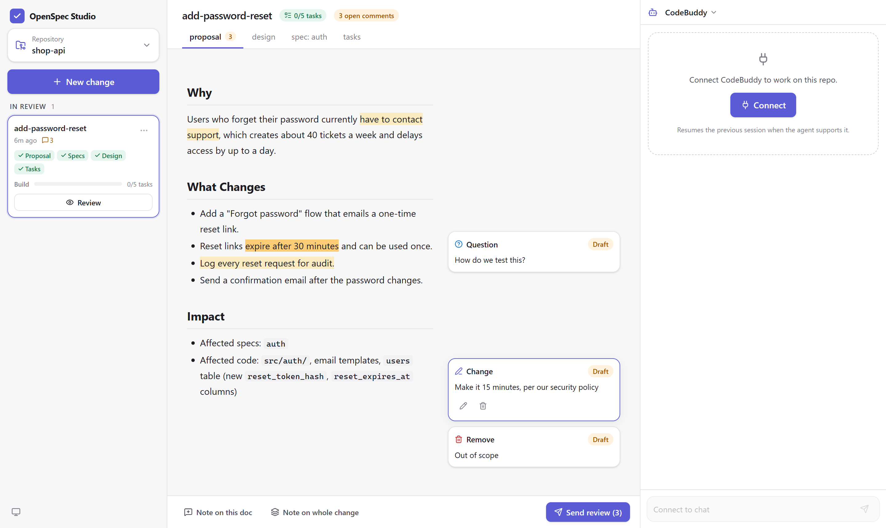
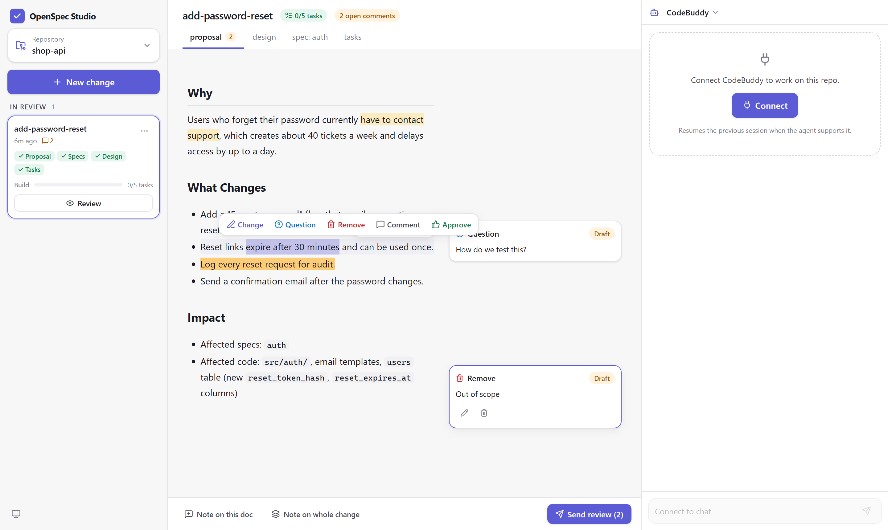
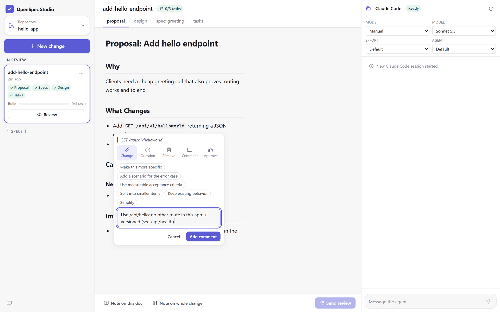

# OpenSpec Studio

A visual, mouse-first workbench for [OpenSpec](https://github.com/Fission-AI/OpenSpec). Pick a repo, drive the whole
spec-driven lifecycle (init → explore/propose → review → build → sync → archive) with buttons, review the planning
documents Google-Docs style, and watch the coding agent work live, including its permission requests and questions.

> **Status:** early, personal project. It works for daily use, but expect rough edges.



**Contents:**
[What it is](#what-it-is) ·
[Quick start](#quick-start) ·
[The screen](#the-screen) ·
[Walkthrough](#walkthrough-from-an-empty-folder-to-an-archived-change) ·
[Reviewing in depth](#reviewing-in-depth) ·
[The agent panel](#the-agent-panel) ·
[Reference](#reference) ·
[Configuration](#configuration) ·
[Agents](#agents) ·
[Making a tutorial or demo](#making-a-tutorial-or-demo) ·
[Platforms](#platforms) ·
[Troubleshooting](#troubleshooting) ·
[Security](#security) ·
[Development](#development)

---

## What it is

### OpenSpec in one minute
OpenSpec is a spec-driven workflow for AI coding agents. Before any code is written, the agent drafts a **change**: a
folder under `openspec/changes/<name>/` with planning documents (**artifacts**):

| artifact | what it holds |
|---|---|
| `proposal.md` | why the change is needed and what changes |
| `specs/<capability>/spec.md` | *delta specs*: requirements that are ADDED / MODIFIED / REMOVED, each with scenarios |
| `design.md` | technical decisions |
| `tasks.md` | the implementation checklist (`- [ ]` items) |

A human reviews and refines these, then the agent **applies** the change (implements the tasks), the delta specs are
**synced** into the main specs under `openspec/specs/`, and the change is **archived** to `openspec/changes/archive/`.
Without Studio, all of this happens through slash commands typed into an agent's terminal (`/opsx:propose`,
`/opsx:apply`, …).

### What Studio adds
- **Buttons instead of commands.** Every lifecycle step is a button; Studio knows each agent's command syntax.
- **A board of changes.** Changes are grouped by stage (Drafting, In review, Ready to build, Building, Done), each with
  its artifacts and task progress, and one obvious next action.
- **Document review like Google Docs.** Select text and comment, or react to a paragraph with one click. Comments stay
  attached to their text even after the agent rewrites the document.
- **Review rounds.** One click sends every comment to the agent as a structured request; the agent answers each comment
  (addressed / partly / declined / answered) and Studio shows a word-level diff of what it changed.
- **The agent, live.** The agent runs inside the repo and streams its messages, thoughts, tool calls, plans and file
  writes. Permission requests and questions appear as cards you answer with a click.
- **Nothing lost on reload.** The server owns the agent session, the event log, comments and review rounds, so you can
  close the tab, reload, or come back later.

### How it fits together
```
Browser (React) ⇄ WebSocket/REST ⇄ Node server ⇄ ACP over stdio ⇄ agent (cwd = repo)
                                     ├─ openspec CLI (--json) + file watcher
                                     └─ SQLite (~/.openspec-studio/studio.db): event log, comments, review rounds
```
- The **server** runs locally. It lists repos in the folders you choose, runs the `openspec` CLI to read change status,
  watches `<repo>/openspec/` for edits, and stores everything else in SQLite.
- Agents are started as child processes speaking the **Agent Client Protocol (ACP)** over stdio, with the repo as the
  working directory. One agent session per repo; several repos can each have their own at the same time.
- The **browser** gets live updates over a WebSocket and calls a small REST API for actions.

---

## Quick start
You need **Node.js ≥ 22.13** (Studio uses the built-in `node:sqlite`) and git.

```bash
# 1. OpenSpec CLI
npm install -g @fission-ai/openspec

# 2. An agent CLI, logged in once from a terminal (see "Agents"), e.g.
codebuddy        # or: claude / codex

# 3. Studio
git clone https://github.com/baabullah/openspec-studio.git
cd openspec-studio
npm install
npm run dev      # API :3940 + web :5173 → open http://127.0.0.1:5173
```

Then open the repo menu → **Add folder…** and pick the folder that holds your repos. Studio lists every git or OpenSpec
repo up to 4 levels inside it. Folders are saved in `~/.openspec-studio/config.json`; add as many as you like.

For everyday use, run a production build on a single port:
```bash
npm run build && npm start   # http://127.0.0.1:3940
```
`npm start` runs the TypeScript server through `tsx` (no separate compile step), so keep the dev dependencies installed;
the startup cost is a second or two and nothing else changes at runtime.

Want to try it without touching a real repo? `npm run demo-repo -- ~/studio-demo --tools claude` creates a small demo
repo with one change ready for review (see [Making a tutorial or demo](#making-a-tutorial-or-demo)).

---

## The screen
Studio is one page with three columns:

```
┌──────────────────┬────────────────────────────────────────────┬──────────────────────┐
│ OpenSpec Studio  │ change-name   0/3 tasks   2 open comments  │ Claude Code   Ready  │
│ [Repository   ▾] │ proposal ② · design · spec: x · tasks      │ MODE ▾     MODEL ▾   │
│ [+ New change]   │────────────────────────────────────────────│──────────────────────│
│                  │                                 ┌────────┐ │ you: Apply · change  │
│ IN REVIEW  1     │  # Proposal: …                  │ Change │ │ agent message        │
│ ┌──────────────┐ │  ## Why                         │ Draft  │ │ ▸ tool call  ✓       │
│ │ change-name  │ │  text with ▒highlight▒ …        └────────┘ │ ▸ plan               │
│ │ ✓Proposal ✓… │ │                                 margin     │ ──── done ────       │
│ │ Build ▓░ 1/3 │ │                                 comments   │ NEEDS YOUR DECISION  │
│ │ [  Review  ] │ │                                            │ [Allow] [Reject]     │
│ └──────────────┘ │────────────────────────────────────────────│──────────────────────│
│ ▸ Archived 3     │ Note on doc · Note on change [Send review] │ Message the agent… ➤ │
│ ◐                │                                            │                      │
└──────────────────┴────────────────────────────────────────────┴──────────────────────┘
  left: repos & changes     middle: the document under review       right: the agent
```

| area | what is there |
|---|---|
| **Left: repo rail** | Repository picker (with **Add folder…**), **New change** button, the changes grouped by stage, then the collapsible **Specs** (main specs) and **Archived** lists, and at the bottom the theme toggle and, when the server is down, the "server offline" badge. |
| **Middle: review pane** | The open change: title, task and open-comment badges, one tab per artifact (`proposal`, `design`, `spec: <capability>`, `tasks`, plus **What changed** after a review round), the rendered document with highlights, margin comments, and the review bar at the bottom. A main spec or an archived change opens here too, read-only. |
| **Right: agent panel** | Agent picker and status, session options (mode, model, …), the live transcript, pinned decisions waiting for you, and a chat box. |

When the document column gets narrow (window under about 1440 px wide), margin comments move into a **Notes** block
above the document. The theme toggle at the bottom left cycles **system → light → dark**.

---

## Walkthrough: from an empty folder to an archived change

### 1. Add the folder with your repos
On first start the middle pane says *"Add the folder with your repos"*. Click **Add folder** (or open the repo menu →
**Add folder…**). The dialog is a small folder browser:
- It starts at your home folder and the folders you already added (on Windows, also every drive). Click a folder to go
  into it; **↑** goes up a level, **⌂** returns to the start.
- Folders that are repos are marked with a **repo** badge.
- You can also type or paste a path (`~` works) and press Enter. Double-clicking a folder puts its path in the box.
- **Add this folder** saves it. Pick the folder that *holds* your repos, or a single repo. A whole drive is refused.

Studio scans the folder (up to 4 levels deep, skipping `node_modules`, `dist`, hidden folders and the like) and lists
every folder that has a `.git` or `openspec` directory. A very large folder is scanned for at most 20 seconds and is
then marked **partial**; add a more specific folder in that case.

### 2. Pick a repo
Open the **Repository** menu at the top left. Repos are grouped under their folder; type in **Filter…** to narrow the
list, **⟳** rescans the folders, and **×** next to a folder removes it from Studio (nothing is deleted on disk). A green
dot marks repos where an agent is connected. Studio remembers the last repo and reopens it next time.

### 3. Initialize OpenSpec (once per repo)
If the repo has no `openspec/` folder, the middle pane shows *"Set up OpenSpec in this repo"*. Choose the agent you will
use (CodeBuddy, Claude Code, Codex) and click **Initialize OpenSpec**. This runs `openspec init --tools <agent>`, which
creates `openspec/` and installs the workflow commands/skills for that agent. Nothing else in the repo changes. The
command's output appears in the agent panel. If an agent session was already running, Studio starts a fresh one so the
agent picks up the new commands.

### 4. Connect the agent
In the right panel, pick the agent from the dropdown next to its name, then click **Connect**. The badge goes
**Starting → Ready**. Claude Code and Codex are fetched by `npx` on first use, so the very first connect can take a
minute. If the agent supports it, Connect **resumes the previous session** for this repo, history included.

You rarely need to connect by hand: every lifecycle button and **Send review** connect the agent first if needed and
wait until it is ready.

### 5. Start a change
Click **New change**. The dialog has two modes:
- **Propose**: describe what should change in a sentence (the chips "Add a feature:", "Fix a bug:", "Refactor",
  "Improve performance of", "Add tests for" start the sentence for you). The agent runs the propose workflow and writes
  `proposal.md`, the delta specs, `design.md` and `tasks.md`.
- **Explore first**: think the idea through with the agent before committing to a change (the text is optional).

Ctrl/Cmd+Enter submits. The agent's work streams into the right panel, and the new change appears in the left rail as
soon as its folder exists. Studio watches the files, so documents update live while the agent writes them.

### 6. Follow the change through its stages
Each change card shows its name, last edit time, open comment count, the artifact chips (✓ when written), a **Build**
progress bar from the `tasks.md` checkboxes, the next unchecked task while building ("Next: 1.2 …"), and one primary
button. Within a stage the newest change comes first; with four or more changes a **Filter changes…** box appears.

| stage (rail heading) | meaning | primary button | what it does |
|---|---|---|---|
| **Drafting** | some planning artifacts are still missing | **Continue** | asks the agent to create the missing artifacts |
| **In review** | all artifacts written; not reviewed yet, or comments still open | **Review** | opens the change in the middle pane |
| **Ready to build** | reviewed (comments exist and all are resolved), no task done yet | **Build it** | runs apply: the agent implements the tasks |
| **Building** | some tasks are checked | **Continue** | runs apply again to continue |
| **Done** | every task is checked | **Archive** (and **Verify**, when installed) | Verify asks the agent to check the code against the specs; Archive asks for confirmation, then runs archive |

A shield mark with a number on a card means `openspec validate` found problems in the change (see
[Checks on the open change](#checks-on-the-open-change)).

The **⋯** menu on each card offers every step at any time: **Open for review**, **Explore with agent**, **Check
coherence** (the update workflow: the agent makes the artifacts consistent with each other), **Build (apply)**, **Verify
implementation**, **Sync specs** and **Archive…**. Actions are disabled while the agent is working.

**Verify** is one of OpenSpec's optional workflows: the agent checks completeness, correctness and coherence of the code
against the change, and changes nothing. Enable it with `openspec config profile`, then run `openspec update` in the
repo; Studio offers it once the repo has it installed.

### 7. Review the documents
Open a change (click its card or **Review**). Read each tab and leave comments, then click **Send review**. The agent
revises the artifacts and reports back on every comment. Repeat until you are happy, resolving each comment as you go.
This loop is described in detail in [Reviewing in depth](#reviewing-in-depth).

### 8. Build
When every comment is resolved, the change moves to **Ready to build**. Click **Build it**. The agent implements the
tasks and ticks them off in `tasks.md`; the progress bar fills as it goes. Watch the right panel for permission
requests (file edits, shell commands) and answer them. When the turn ends, its end line says what actually happened
according to the agent's tool calls, e.g. **ran 2 commands · 1 failed · changed 2 files**; click it for each command
with ✓/✗ and each file, so "all tests pass" is something you can check, not just read.

### 9. Sync and archive
When all tasks are done the change moves to **Done**. **Archive** opens a confirmation: the agent checks that the change
is complete, merges its delta specs into the main specs and moves the folder to `openspec/changes/archive/`. Use **Sync
specs** from the ⋯ menu to merge the specs without archiving. Archived changes are listed under **Archived** at the
bottom of the rail.

### 10. Look back: archived changes and main specs
Both are read-only views in the middle pane (a **read-only** tag in the header; no comment toolbar, no review bar):
- **Archived** (collapsible, newest first): click a change to open it as it was archived, one tab per artifact, plus a
  **History** tab with every review round Studio ran for it: the comments with their verdict and the agent's note, and
  the word-level diff of what each round changed. Studio finds the history by the change's name (archiving only adds a
  date prefix to the folder). If a new active change took the same name, the history is shown with that change instead.
  Changes reviewed without Studio have no history.
- **Specs** (collapsible): the main specs in `openspec/specs/`, one per capability with its number of requirements.
  Click one to read its `spec.md`: what the system does today, after every archived change was merged in. It updates
  live when a sync or archive changes it.

To change a spec, start a new change; specs are not edited directly.

---

## Reviewing in depth

### Checks on the open change
Two bars can appear under the change's header, and both clear by themselves once the files are fixed:
- **OpenSpec validation: 1 error, 1 warning**: the result of `openspec validate` for this change (for example a
  requirement without a scenario, or without SHALL/MUST). Click it to list each finding with its file. **Ask agent to
  fix** sends the findings to the agent through the update workflow.
- **The proposal changed after the specs, the design and the tasks were written; they may be out of date.**: an
  artifact was edited after the ones that depend on it (OpenSpec's own dependency order: proposal → specs and design →
  tasks). The affected tabs get an amber dot. **Check coherence** asks the agent to bring exactly those artifacts in line
  and change nothing else; **Dismiss** hides the warning until something changes again.

### Leaving comments
There are four ways to comment:

1. **Select text** in the document → a floating toolbar appears: **Change · Question · Remove · Comment · Approve**.

   

2. **Hover a heading, paragraph or list item** → the same five reactions appear as small icons at its edge; they apply
   to the whole block.
3. **Note on this doc** (review bar) → a comment on the current file as a whole.
4. **Note on whole change** (review bar) → a comment on the change as a whole (shown with a "whole change" tag).

Choosing a kind opens the comment editor, with the quoted text on top, the kind (switchable), suggestion chips and a
note field. **Approve** is saved immediately, without the editor.



| kind | for | suggestion chips | note required |
|---|---|---|---|
| **Change** | "change this" | Make this more specific · Add a scenario for the error case · Use measurable acceptance criteria · Split into smaller items · Keep existing behavior · Simplify | yes |
| **Question** | ask; the agent answers and edits only if the answer implies a change | Why is this needed? · What happens on failure? · Is there a simpler alternative? · Who is affected? · How do we test this? | yes |
| **Remove** | "remove this" | Out of scope · Duplicate · Not needed now | no |
| **Comment** | a general remark | Looks risky · Needs a design note · Consider backward compatibility · Check security impact | yes |
| **Approve** | "keep as is": the agent must not change it unless another comment requires it | none | no |

In the editor, Ctrl/Cmd+Enter saves and Esc cancels.

### Comments in the margin
Each comment is a card next to the text it quotes, and the text is highlighted. Clicking highlighted text focuses its
comment; clicking a card focuses it and shows its actions. Tabs show the number of open comments per file, and the
header shows the total. A new comment is a **Draft**: you can edit (✎) or delete (🗑) it until it is sent.

### Sending a review round
**Send review (N)** sends all drafts at once (connecting the agent if needed). Studio:
1. takes a snapshot of every artifact of the change,
2. sends the agent one structured prompt: the agent's update command (e.g. `/opsx:update <change>`) followed by every
   comment with its id, kind, file, heading path, approximate line, quote and note, plus rules (edit only what the
   feedback targets, keep the artifacts coherent, write no code, leave approved parts alone),
3. asks the agent to end its reply with a `review-result` block giving a verdict and a short note for every id.

While the agent works, the bar shows **Agent is revising…** and sent comments show **With agent** (they cannot be
edited or deleted until the round ends). Approve comments are resolved right away.

### Reading the result
When the turn ends, each comment shows the agent's verdict and note:

| status | meaning |
|---|---|
| **Addressed** | the agent changed the document as asked |
| **Partly addressed** | some of it |
| **Declined** | the agent disagrees; the reason is in its note |
| **Answered** | a question was answered |
| **No report** | the agent did not report on this comment (no or broken `review-result` block) |

A banner says *"The agent revised N files…"* with **View changes** and **Dismiss**. The **What changed** tab lists every
round, newest first: round number and time, the comments it covered (click one to jump to it in its document),
warnings such as *agent sent no report* or the stop reason, and a **word-level diff per file** (long unchanged stretches
are collapsed).

### Closing the loop
For each answered comment, either **Resolve** it (✓) or **Reopen** it: reopening opens the editor so you can refine the
note, and the comment goes out again with the next round. **N to check · resolve addressed** in the review bar resolves
every *Addressed* comment at once. Resolved comments are hidden; **Show N resolved** in the Notes block brings them back.
When every comment of a change is resolved, the change moves to **Ready to build**.

### When the agent stops early
If the review turn ends early (refusal, error, token or step limit), the round stays open and the bar shows **Revision
stopped (reason)** with **Continue** (asks the agent to carry on where it left off) and **Close round** (finish the
round with whatever the agent did so far). Starting another lifecycle action also closes a waiting round.

### Specs read as specs
Spec files (main and delta) are rendered with their structure: **Requirement** and **Scenario** labels, a separator
between requirements, indented scenario steps with **WHEN** / **THEN** / **GIVEN** pills, emphasised SHALL / MUST / MAY,
and a coloured edge on ADDED / MODIFIED / REMOVED sections. Comments work the same on them.

### Keeping the review with the change
In the **Repository** menu, **Keep review history in <repo>** writes each change's comments and finished review rounds
to `openspec/changes/<change>/.studio-review.json` whenever the review changes. Commit it and the review travels with the
branch and the PR; `openspec archive` moves it along with the change. It holds no machine-specific paths and is only
rewritten when its content changes. Studio always reads these files: an archived change shows the history from its
file, and an active change with no history in Studio (a teammate's branch) imports it.

### Comments survive edits
A comment is anchored by its quote plus the text around it, with the heading path and line as tie-breaks and fuzzy
matching as a fallback. After the agent rewrites a document, comments re-attach to the same text. A comment whose text
was edited shows *"Text edited since this comment"*; one whose text is gone shows *"Quoted text no longer in the
document"* and moves to the Notes block.

---

## The agent panel

### Header
- **Agent name ▾**: choose the agent for this repo (only while disconnected). The choice is remembered per repo.
- **Status badge**: Starting · Ready · Working (with an elapsed timer) · Stopped · Error.
- **Context gauge and cost**: how full the agent's context window is (amber from 60%, red from 85%) and the session
  cost when the agent reports one, e.g. `8% $0.096`. Hover for the context in tokens and the token totals of the
  current session.
- **Stop**: cancels the current turn (only while working).
- **⏻ menu**: **New session** (start fresh instead of resuming) and **Disconnect agent**.
- **Session options**: whatever the agent offers, as dropdowns, e.g. *Mode* (how much the agent may do without
  asking), *Model*, *Effort*. Changes apply to the running session.

### Transcript
In order of appearance:
- **Your requests.** Lifecycle actions show as a labeled bubble ("Apply · add-auth", "Review sent · 3 items · add-auth"),
  chat messages as their text.
- **Agent messages** (Markdown) and **Thinking** (the agent's reasoning, collapsed; click to expand).
- **Tool calls** as cards with title, kind, status (pending / in progress / completed / failed), output and file
  locations.
- **Plans** (the agent's to-do list), updated in place.
- **Wrote** lines listing files the agent wrote through Studio.
- **Notices** from Studio (session started/resumed, `openspec init` output, errors).
- **A divider at the end of every turn**: *done*, *cancelled*, or a red box explaining an early stop (refusal, token
  limit, step limit, error) with a **Continue** button. Under it, the tokens the agent reported for that turn:
  `in 1.2k · cache 9.8k read · 450 write · out 310`.

The panel follows the stream unless you scroll up. The history is kept on the server (the last 2000 events per repo are
shown), so a reload or a second browser tab shows the same transcript.

### Decisions waiting for you
When the agent asks for permission (edit a file, run a command, …) or asks a question, a card is pinned above the chat
box under **Needs your decision**, so it cannot scroll away:
- **Permission cards** say "The agent wants to: …", show the command or path, and a diff for file edits, with the
  agent's options as buttons (e.g. *Allow once* in green, *Allow always*, *Reject* in red).
- **Question cards** show a small form: choices (a single choice answers with one click), checkboxes, text or number
  fields, with **Submit** and **Decline**.

While a decision is pending the browser tab title reads **"(1) Needs you · OpenSpec Studio"**, and if the tab is in the
background Studio shows a desktop notification. The same happens when a turn finishes while you are elsewhere: a
notification such as "Done · hello-app — Apply · add-hello-endpoint" and **"✓ Agent finished"** in the tab title until you
come back. The browser asks for notification permission when you first click Connect.

### Token usage by agent
Studio shows what the agent reports over ACP and nothing it has to guess:

| agent | context gauge | session cost | tokens per turn (input, cache read/write, output) |
|---|---|---|---|
| Claude Code | yes | yes (USD) | yes |
| Codex | yes | no | yes |
| CodeBuddy | yes | no (it reports credits in its own format) | not confirmed |

### Chat
The box at the bottom sends free-form messages to the agent (Enter sends, Shift+Enter adds a line). Use it to ask about
the change or give extra instructions.

---

## Reference

### Mouse and keyboard
| where | action |
|---|---|
| document | select text → comment toolbar · hover a block → reactions · click highlighted text → focus its comment |
| comment editor | Ctrl/Cmd+Enter save · Esc cancel |
| New change dialog | Ctrl/Cmd+Enter submit |
| folder dialog | Enter opens the typed path · double-click copies a folder's path into the box |
| chat box | Enter send · Shift+Enter new line |

### Live updates and reconnecting
- Edits to files under `<repo>/openspec/` (by the agent, your editor or git) refresh the change list and the open
  document within a second. On Windows drives mounted in WSL (`/mnt/...`) Studio polls instead, so it is a bit slower.
- If the server stops, the bottom-left badge shows **server offline · reconnecting…** and the page retries with backoff.
  When the server is back, Studio reloads the repo list, the changes, the open document and the review, so nothing
  stays stale.
- Agent sessions live on the server: closing the tab does not stop the agent. Stopping the server stops all agents.

### What Studio writes, and where
| place | content |
|---|---|
| `~/.openspec-studio/studio.db` | agent session ids (for resume), the event log, comments, review rounds with snapshots and diffs |
| `~/.openspec-studio/config.json` | the folders you added |
| `~/.openspec-studio/agents.json` | your custom agents (optional, you write it) |
| your repo | Nothing by default. With **Keep review history** on: `.studio-review.json` in each reviewed change folder. `openspec init` (when you click Initialize) and the agent write there too. |

### Limits
- Files larger than 2 MB (`MAX_DOC_BYTES`) are not opened or snapshotted.
- The event log keeps about the last 5000 events per repo; the page shows the last 2000.
- The folder browser shows the first 400 sub-folders; type a path to go further.

---

## Configuration
All optional, as environment variables:

| variable | default | meaning |
|---|---|---|
| `REPOS_ROOT` | none | a folder that is always listed, in addition to the ones picked in the UI |
| `PORT` | `3940` | server port |
| `HOST` | `127.0.0.1` | bind address; keep it local (see Security) |
| `ALLOWED_HOSTS` | none | extra host names the server answers to, comma separated |
| `DEFAULT_AGENT` | `codebuddy` | agent selected for new repos |
| `STUDIO_DATA` | `~/.openspec-studio` | database, config and `agents.json` |
| `STUDIO_DB` | `<STUDIO_DATA>/studio.db` | database file |
| `REPO_SCAN_DEPTH` | `4` | how deep to look for repos inside a folder |
| `OPENSPEC_BIN` | `openspec` | OpenSpec CLI to run |
| `OPENSPEC_TELEMETRY` | `0` for Studio's own CLI calls | set it to override |
| `MAX_DOC_BYTES` | `2097152` | largest spec file the server opens or snapshots (bigger ones get a 413 / a marker) |

## Agents
| id | how it runs | login | OpenSpec invocation |
|---|---|---|---|
| codebuddy | `codebuddy --acp` | run `codebuddy` once and sign in | `/opsx:<cmd>` |
| claude | `npx @agentclientprotocol/claude-agent-acp` | sign in to Claude Code (`claude`), or set `ANTHROPIC_API_KEY` | `/opsx:<cmd>` |
| codex | `npx @agentclientprotocol/codex-acp` | `codex login`, or set `OPENAI_API_KEY` | `$openspec-<skill>` |

The Claude and Codex adapters are downloaded by `npx` the first time you connect, so that first start takes a while.

How the buttons map to OpenSpec workflows:

| button | workflow | slash style (CodeBuddy, Claude) | skill style (Codex) |
|---|---|---|---|
| New change → **Propose** | propose | `/opsx:propose <text>` | `$openspec-propose <text>` |
| New change → **Explore**, ⋯ **Explore with agent** | explore | `/opsx:explore <text>` | `$openspec-explore <text>` |
| **Continue** (Drafting), ⋯ **Check coherence**, **Send review** | update | `/opsx:update <change> …` | `$openspec-update-change <change> …` |
| **Build it**, **Continue** (Building), ⋯ **Build (apply)** | apply | `/opsx:apply <change>` | `$openspec-apply-change <change>` |
| ⋯ **Sync specs** | sync | `/opsx:sync <change>` | `$openspec-sync-specs <change>` |
| **Archive** | archive | `/opsx:archive <change>` | `$openspec-archive-change <change>` |

Add or override agents in `~/.openspec-studio/agents.json`:
```json
[{ "id": "gemini", "label": "Gemini", "cmd": "gemini", "args": ["--experimental-acp"], "openspecTool": "gemini", "style": "slash" }]
```
`style` is `slash`, `skill`, or a template like `"/my:{action} {args}"` (`{skill}` is also available). `openspecTool`
is the value passed to `openspec init --tools`; leave it out and the agent is not offered on the Initialize screen.
Changes to the file apply without a restart. Any agent that speaks ACP over stdio works.

Behind a corporate proxy: Studio copies lowercase `http_proxy` / `https_proxy` / `no_proxy` to their uppercase names
for the agent process, so every HTTP client in it sees them.

---

## Making a tutorial or demo
This section is for recording a video, taking screenshots or giving a live demo.

### Set up a safe demo environment
1. **Use a separate data folder** so the demo starts clean and your own folders, comments and sessions stay out of it:
   ```bash
   # macOS / Linux / WSL
   STUDIO_DATA=~/studio-demo-data npm start
   # Windows (cmd)
   set STUDIO_DATA=%USERPROFILE%\studio-demo-data&& npm start
   ```
   Delete that folder to start over.
2. **Create a demo repo** instead of using a real project:
   ```bash
   npm run demo-repo -- ~/studio-demo --tools claude    # or codebuddy / codex: the agent you will show
   ```
   This creates `~/studio-demo/hello-app`: a tiny HTTP API with **no dependencies** (`node:http`, tests with
   `node:test`, so `npm test` works without `npm install`), a main spec (`health`) and one change,
   **add-hello-endpoint**, whose proposal, design, delta spec (`greeting`) and three tasks are all written, so it opens
   in **In review**. The tasks are small and real (a handler, a route, a test), so **Build it** can finish them.
   `--tools` installs that agent's OpenSpec commands so review and build work. Run the command again to reset the repo.
   To film the *Initialize OpenSpec* screen as well, create an empty git repo (`git init`) next to it in the same folder.
3. **Log in to the agent beforehand** and connect it once off-camera: the first connect of Claude Code or Codex
   downloads the adapter and takes a while.
4. Run the **production build** (`npm run build && npm start`: one port, no dev tooling) and open
   `http://127.0.0.1:3940` in a window **at least 1440 px wide** (e.g. 1440×900), so all three columns and the margin
   comments are visible. Narrower, and the comments move into the Notes block above the document.
5. The theme follows the system; use the toggle at the bottom left to force light or dark.

### Suggested storyboard
Each scene lists what to click and what appears. Agent turns take from a few seconds to a few minutes; trim the waits.

| # | scene | do | on screen |
|---|---|---|---|
| 1 | Intro | open Studio | three columns; middle says *"Add the folder with your repos"* |
| 2 | Add a folder | **Add folder** → browse to `studio-demo` (or paste its path) → **Add this folder** | the dialog closes; the repo menu lists `hello-app` |
| 3 | Pick the repo | Repository menu → **hello-app** | left rail: **New change** button and **IN REVIEW 1** with the `add-hello-endpoint` card (artifact chips ✓, Build 0/3 tasks) |
| 4 | Connect the agent | right panel: pick the agent → **Connect** | badge Starting → **Ready**; Mode / Model dropdowns appear |
| 5 | Open the change | click the card or **Review** | header `add-hello-endpoint`, tabs `proposal · design · spec: greeting · tasks`, the proposal rendered |
| 6 | Tour the artifacts | click each tab | design decisions; the delta spec with an ADDED requirement and its scenario; the task checklist |
| 7 | Comment on a selection | proposal: select `GET /api/v1/helloworld` → **Change** → type "Use /hello without the version prefix" → **Add comment** | highlight + margin card **Change · Draft**; tab badge 1; **Send review (1)** |
| 8 | Ask a question | hover "Log every call at debug level." → the **?** icon (Question) → chip *Why is this needed?* → **Add comment** | a second card **Question · Draft** |
| 9 | Approve | hover the paragraph under *Why* → the 👍 icon | an **Approve** card (resolved as soon as the review is sent) |
| 10 | Whole-change note | **Note on whole change** → "Keep the response format JSON" → **Add note** | a card in the Notes block tagged "whole change" |
| 11 | Send the review | **Send review (4)** | bar: *Agent is revising…*; cards *With agent*; the agent panel streams its work and file writes; the document updates live |
| 12 | Answer a permission (if the mode asks) | click **Allow** on the pinned card | the card resolves; the agent continues |
| 13 | Read the verdicts | wait for the *done* divider | cards show *Addressed* / *Answered* with the agent's notes; banner *"The agent revised N files"* |
| 14 | What changed | **View changes** | *Round 1* with the comment chips and a word-level diff per file |
| 15 | Close the loop | **N to check · resolve addressed**, then **Resolve** on the answered question and the note | cards fade; the change moves to **Ready to build** |
| 16 | Build | **Build it** | the agent writes `src/routes/hello.js`, registers the route in `src/app.js`, adds `test/hello.test.js`, runs `npm test` and ticks `tasks.md`; the progress bar fills; header `3/3 tasks`; the card moves to **Done** |
| 17 | Archive | card → **Archive** → **Archive** in the dialog | the agent turns the delta spec into the new main spec `openspec/specs/greeting/spec.md` and moves the change; it appears under **Archived** |
| 17a | Look back at it | **Archived** → `<date>-add-hello-endpoint` → **History** | the artifacts as archived (read-only), and Round 1 with each comment's verdict, the agent's notes and the diff |
| 17b | The main specs | **Specs** → `greeting` | the new `greeting` spec with its requirement, read-only, next to the existing `health` spec |
| 18 | Start the next one | **New change** → Propose → "Add a goodbye endpoint" → **Propose** | the agent drafts a new change; its card appears under **Drafting**, then **In review** |

Optional extras: reload the page to show that comments and the transcript survive; toggle dark mode; stop and restart
the server to show the reconnect badge and the automatic refresh; open the ⋯ menu on a card to show every step.

### Tips
- The left rail, the open document and the agent transcript update by themselves; no refresh is needed on camera.
- The agent's wording, the files it edits and its verdicts vary from run to run. Re-run `npm run demo-repo` (and delete
  the demo data folder) to retake a scene from the same starting point.
- Permission prompts depend on the agent's **Mode** dropdown. A mode that asks before edits makes the permission cards
  visible; a more permissive mode makes the build faster to film.
- The agent's login, model name and file paths are visible on screen; pick a demo folder whose path you are fine
  showing.

---

## Platforms
Tested on **Linux**, **WSL** and **native Windows**. **macOS** should work the same way but has not been tested yet;
reports are welcome.

- **Windows:** npm-installed CLIs are `.cmd` shims; the server launches them via cross-spawn and stops agents with their
  whole process tree. Use `cmd` or PowerShell, whichever your machine allows.
- **WSL with repos on `/mnt/c`:** works, but file watching falls back to polling and installs/builds are slow. Prefer
  keeping repos in the Linux filesystem, or run Studio with Windows Node instead. A browser on Windows can open a Studio
  running in WSL at `http://127.0.0.1:3940` (WSL forwards localhost).
- **Install with the same OS you run on:** `node_modules` contains native binaries (esbuild, rolldown), so a folder
  installed from WSL won't run under Windows Node and vice versa. Use a separate clone per OS.

## Troubleshooting
- **The page loads but shows connection errors / `ECONNREFUSED 127.0.0.1:3940` in the terminal.** A few right after
  `npm run dev` starts are normal while the server compiles. If they continue, check that `node_modules` was installed
  on the same OS you run on (see above), and that no older Studio process still holds port 3940.
- **"server offline · reconnecting…" stays at the bottom left.** The server is not running or not reachable; start it
  again and the page reconnects by itself.
- **The agent does not start, or says it needs a login.** Run the agent's CLI once in a terminal and sign in (see
  Agents), then click **Connect** again. The error in the agent panel shows the last lines the agent printed.
- **"The agent is still working".** One turn runs at a time per repo. Wait, or press **Stop**.
- **The agent is very slow or keeps "thinking" without answering.** Some models loop on reasoning-only replies. Switch
  the model in the agent panel (for CodeBuddy, e.g. `glm-5.3`).
- **Comments show "No report".** The agent did not end its reply with a valid `review-result` block. Check the
  document yourself, then resolve or reopen; reopened comments go out again in the next round.
- **Every OpenSpec action takes ~10 seconds behind a proxy.** That is the CLI's telemetry request timing out. Studio sets
  `OPENSPEC_TELEMETRY=0` for its own calls unless you set it yourself.
- **A repo is missing from the list.** It must contain `.git` or `openspec/` and be at most 4 levels below an added
  folder (`REPO_SCAN_DEPTH`). Use **⟳** in the repo menu to rescan; a folder marked **partial** was too large to scan
  fully.
- **`npm install` prints `install-scripts` warnings.** Newer npm versions ask before running install scripts; Studio
  works without them, so they can be ignored.

## Security
The agent can run code. The server binds to localhost and only answers requests whose `Host` is localhost/127.0.0.1/[::1]
(or `ALLOWED_HOSTS`), which blocks DNS-rebinding attacks from web pages. WebSocket and mutating requests must also come
from the same origin, and POST bodies must be JSON. Repos are limited to the folders you added, files are served only
from `<repo>/openspec`, and the agent's ACP file reads/writes are confined to the repo. The agent's own tools (shell
commands and so on) run with whatever its permission mode allows, so keep an eye on the permission cards. There is no
authentication: do not expose Studio on a network.

## Development
```bash
npm run dev        # server (tsx watch) + web (vite) with hot reload
npm test           # unit tests (vitest): server, then web
npm run typecheck  # server + web
npm run lint       # biome (lint only; the formatter is off)
npm run build      # web production build into web/dist (served by npm start)
npm run demo-repo -- <folder> [--tools <agent>]   # disposable demo repo
```

Project layout:
```
server/src/   index.ts (HTTP + WebSocket), acp/hub.ts (agent sessions), openspec.ts (CLI), review/ (rounds, prompt,
              result parser), workspace.ts (folders, repo scan), db.ts (SQLite), schemas.ts (request validation),
              security.ts (Host/Origin/CSRF), agents.ts (built-in + agents.json)
web/src/      store.ts (state + socket), panes/ (RepoRail, DocReview, AgentPanel, Folders), review/ (comments,
              text model, diff), agent/ (transcript cards)
shared/       protocol.ts (types shared by both sides), anchor.ts (comment anchoring)
scripts/      dev.mjs (dev launcher), demo-repo.mjs
```

Server tests cover comment anchoring, the review prompt and `review-result` parser, review rounds, request schemas,
custom agents, the path sandbox, the Host/Origin/CSRF checks, and workspace folders (scan, sandbox, data migration).
Web tests cover the transcript fold and the document text model (under jsdom).

CI runs lint, typecheck, tests and the build on Linux and Windows (Node 22 and 24) for every push to `main` and every
pull request. Lint warnings (mostly accessibility) are a known backlog and don't fail the build; errors do.

Line endings are pinned to LF by `.gitattributes`, so editing from Windows and WSL doesn't show every file as changed.

## License
MIT, see [LICENSE](LICENSE).
